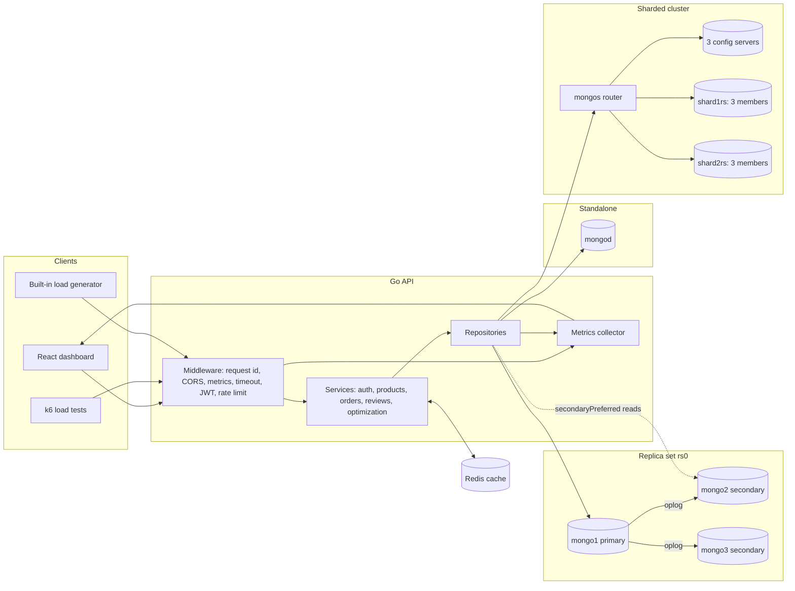

# MongoScale

MongoScale is a MongoDB performance lab for a college presentation. It is a complete e-commerce platform (Go API, React dashboard, MongoDB, Redis, k6) that you can run in two states:

- **Unoptimized**: no secondary indexes, regex search, skip pagination, full documents, a 10-connection pool and primary-only reads. Under load it times out and returns errors.
- **Fully optimized**: indexes, replica-set reads and writes, hashed sharding, projections, keyset pagination, Redis caching, rate limiting and a 200-connection pool. Under much more load it stays fast.

The dashboard turns that difference into something an audience can see: a red "SYSTEM UNDER STRESS / CRASH RISK" state with shaking cards and failing requests, and a green "SYSTEM HEALTHY / SCALED" state with stable charts, healthy replicas and balanced shards.

> **Honest note about results.** Every number in the dashboard is measured live from the API you are running. The numbers in the "Expected results" section are typical ranges, not guarantees. They depend on your machine's CPU, RAM and Docker settings. Run the unoptimized test once before the presentation so you know what your machine does.

## Contents

1. [Quick start](#quick-start)
2. [Architecture](#architecture)
3. [MongoDB collection design](#mongodb-collection-design)
4. [Indexing strategy](#indexing-strategy)
5. [Replica set](#replica-set)
6. [Sharding](#sharding)
7. [The five optimization modes](#the-five-optimization-modes)
8. [Docker setup](#docker-setup)
9. [Environment variables](#environment-variables)
10. [API documentation](#api-documentation)
11. [k6 load tests](#k6-load-tests)
12. [Running the unoptimized demo](#running-the-unoptimized-demo)
13. [Running the optimized demo](#running-the-optimized-demo)
14. [Expected results](#expected-results)
15. [Five-minute presentation script](#five-minute-presentation-script)
16. [Project layout](#project-layout)
17. [Known limitations](#known-limitations)

## Quick start

Requirements: Docker with Compose v2 and at least 6 GB of RAM available to Docker (10 GB for the sharded stack).

```bash
docker compose up --build
```

Then open:

| URL | What |
| --- | --- |
| http://localhost:3000 | React app and dashboard |
| http://localhost:8080/health | API health check |

Sign in with the admin account (defaults: `admin@mongoscale.dev` / `Admin@12345`, set by `ADMIN_EMAIL` and `ADMIN_PASSWORD`). Customers seeded by the seed command use `user00001@example.com` to `user05000@example.com` with the password `Password123!`.

The first start seeds 5,000 users, 500 products, 50,000 orders and 100,000 reviews. This takes about a minute. Seeding is idempotent: later starts detect the data and skip it.

To change settings, copy `.env.example` to `.env` first. Every variable has a working default, so this is optional for a local demo.

The Go dependencies are resolved while the image builds (`go mod tidy` runs in the Dockerfile). To commit a `go.sum`, run `make tidy` once.

## Architecture



Request flow: the metrics middleware records every request, the service layer decides what to do based on the active optimization mode, the repository runs the MongoDB query, and the collector turns request and command-monitor events into per-second metrics that the dashboard polls.

Only one MongoDB topology is active per Docker stack. The optimization mode switches application behaviour (indexes, caching, read preference, projections, pool size) at runtime. The topology (standalone, replica set, sharded cluster) is chosen by the compose file you start.

## MongoDB collection design

| Collection | Fields | Notes |
| --- | --- | --- |
| `users` | `_id`, `name`, `email`, `passwordHash`, `role`, `createdAt`, `updatedAt` | Unique index on `email`. Passwords are hashed with bcrypt. |
| `products` | `_id`, `name`, `description`, `category`, `price`, `stock`, `rating`, `ratingCount`, `imageUrl`, `createdAt`, `updatedAt` | `rating` and `ratingCount` are updated atomically with an update pipeline when a review is posted. |
| `orders` | `_id`, `userId`, `items[]`, `totalAmount`, `status`, `paymentStatus`, `shippingAddress`, `createdAt`, `updatedAt` | Order items are **embedded** (product id, name, price, quantity) so an order is read with one query and keeps the price paid. |
| `reviews` | `_id`, `productId`, `userId`, `rating`, `comment`, `createdAt`, `updatedAt` | Referenced by `productId`; summaries use an aggregation. |
| `loadtest_results` | mode, topology, users, latency percentiles, throughput, error rate | A fifth collection that stores completed built-in load tests for the before/after screen. |

Schema decisions:

- **Embed order items.** Orders are always read together with their items, items never change after purchase, and a historical price must not change when the catalogue changes.
- **Reference reviews.** There are many reviews per product, so embedding would create unbounded documents.
- **No `$lookup` and no N+1.** Order creation loads all products in a single `$in` query. Lists return embedded data only.
- **Stock reservation.** An order decrements stock with one unordered bulk write whose filters require `stock >= quantity`. A reservation token marks the updated products, so a partial failure is rolled back precisely. Cancelling an order restores stock and sets the status inside a multi-document transaction when the topology supports it (replica set or sharded), and with a guarded sequential fallback on a standalone node.

## Indexing strategy

| Collection | Index | Serves |
| --- | --- | --- |
| `users` | `{ email: 1 }` unique | login, duplicate-email protection |
| `products` | `{ category: 1, price: 1 }` | category browsing sorted by price |
| `products` | `{ name: "text" }` | product search with `$text` |
| `products` | `{ rating: -1 }` | top-rated listing |
| `orders` | `{ userId: 1, createdAt: -1 }` | a user's order history, newest first |
| `orders` | `{ status: 1, createdAt: -1 }` | admin order queues by status |
| `orders` | `{ userId: "hashed" }` | the shard key for the sharded cluster |
| `reviews` | `{ productId: 1, createdAt: -1 }` | recent reviews of a product |
| `reviews` | `{ productId: 1, rating: -1 }` | rating distribution (covered aggregation) |

Compound indexes follow the equality-sort-range rule: the equality field first, then the sort field.

**Proving it.** The dashboard runs `explain` with `executionStats` for four representative queries and shows the winning plan (`COLLSCAN` in red, `IXSCAN` in green), documents examined, documents returned and execution time. It also shows `$indexStats` access counts for every index. In unoptimized mode the review lookup examines about 100,000 documents to return 20; with the index it examines 20.

To inspect the same thing from a shell:

```bash
docker compose exec -T mongo mongosh --quiet < backend/scripts/explain-queries.js
```

## Replica set

`docker-compose.replica.yml` starts three `mongod` nodes (`rs0`). An init container runs `rs.initiate` with `mongo1` at priority 2, so it becomes primary.

What the application does with it:

- **Writes to orders and other writes use `w: "majority"`** in replica-set, sharded and fully-optimized modes, so an acknowledged order survives a primary failure.
- **Product browsing, review lists and summaries use `secondaryPreferred` reads**, which moves read load to the secondaries.
- **Automatic failover.** Press **Trigger failover** on the Architecture page (it calls `replSetStepDown` on the primary), or run `backend/scripts/failover-demo.sh`, which stops the primary container. A secondary is elected within seconds and the topology view redraws with the new primary. The Go driver rediscovers the primary on its own.

## Sharding

`docker-compose.sharded.yml` starts three config servers (`cfgrs`), two shard replica sets of three members each (`shard1rs`, `shard2rs`) and a `mongos` router. The API connects to `mongos`.

The **orders** collection is sharded with `{ userId: "hashed" }`.

Why a hashed `userId`:

- ObjectIds increase monotonically. A ranged shard key on a monotonic value sends every new insert to the same chunk and shard, which is a write hotspot.
- Hashing scatters inserts evenly over all shards, so write throughput scales with the number of shards.
- Queries that filter on `userId` (order history, order creation) still target exactly one shard, because hashed equality routes to a single chunk.
- The trade-off: range queries on `userId` become scatter-gather, which this application never does.

The seed command shards `orders` before inserting, so distribution is visible immediately. The Architecture page shows the document count and size on each shard, the shard key, and the members and states of each shard replica set.

## The five optimization modes

Switch modes from the dashboard, or with `POST /api/v1/system/optimizations/{mode}/toggle`. Switching is live, so you can change mode in the middle of a load test and watch the system recover. Modes are cumulative.

| Mode | What changes |
| --- | --- |
| `unoptimized` | Drops every secondary index. Regex search (collection scan), skip/limit pagination plus `countDocuments`, full documents, pool of 10 connections, `w: 1`, primary reads, no cache, no rate limit. |
| `indexed` | Creates the compound, text and unique indexes. Search uses `$text`. |
| `replica-set` | Indexes + `secondaryPreferred` reads + `w: "majority"` + pool of 60. Needs the replica compose file to have an effect. |
| `sharded` | Replica-set behaviour + shards `orders` on hashed `userId` + projections + keyset pagination + pool of 120. Needs the sharded compose file for the sharding part. |
| `fully-optimized` | Everything above + Redis caching (listings, details, categories, review summaries; versioned keys, 30-60 s TTL) + per-client rate limiting on search, orders and reviews + pool of 200. |

If a mode needs a topology that is not running (for example `sharded` on the standalone stack), the API applies everything it can and returns a `warnings` list that the dashboard shows. Nothing fails silently.

## Docker setup

| Command | Stack |
| --- | --- |
| `docker compose up --build` | Standalone MongoDB, Redis, API, seed job, React app. Starts in `unoptimized` mode. |
| `docker compose -f docker-compose.replica.yml up --build` | 3-node replica set. Starts in `replica-set` mode. |
| `docker compose -f docker-compose.sharded.yml up --build` | Config servers, 2 shards x 3 members, mongos. Starts in `sharded` mode. |
| `docker compose -f docker-compose.loadtest.yml up --build` | Standalone stack + Prometheus + Grafana + a k6 smoke test. |

Shared properties of all stacks: pinned image versions, health checks with `depends_on: condition: service_healthy`, a one-shot seed job, named volumes for MongoDB data, a dedicated bridge network per stack, CPU and memory limits, JSON log rotation (10 MB x 3) and `restart: unless-stopped`. The API image is a multi-stage build that ends in a distroless, non-root image containing only static binaries.

Stop a stack and delete its data with `docker compose -f <file> down -v`, or run `make clean` to remove all four.

The sharded stack runs ten MongoDB processes. Give Docker about 10 GB of RAM, or run the replica stack instead.

## Environment variables

All configuration comes from environment variables. The compose files set safe demo defaults; override them in `.env` for anything beyond a local demo (in particular `JWT_SECRET` and `ADMIN_PASSWORD`).

| Variable | Default | Meaning |
| --- | --- | --- |
| `JWT_SECRET` | demo value in compose | HMAC secret for JWTs. At least 16 characters. Required. |
| `ADMIN_EMAIL`, `ADMIN_PASSWORD` | `admin@mongoscale.dev`, `Admin@12345` | Admin account created or updated at API start. Password required, at least 8 characters. |
| `HTTP_PORT` | `8080` | API listen port. |
| `MONGO_URI` | set by each compose file | MongoDB connection string. |
| `MONGO_DATABASE` | `mongoscale` | Database name. |
| `REDIS_ADDR`, `REDIS_PASSWORD` | `redis:6379`, empty | Redis. If empty or unreachable, caching is disabled and the API still works. |
| `INITIAL_MODE` | `unoptimized` / `replica-set` / `sharded` | Mode applied at startup. |
| `BCRYPT_COST` | `6` (compose), `10` (code default) | Cost for registration and admin hashing. Keep it low for load tests. |
| `JWT_TTL_MINUTES` | `720` | Token lifetime. |
| `REQUEST_TIMEOUT_MS` | `8000` | Per-request context deadline. |
| `MONGO_OP_TIMEOUT_MS` | `5000` | Per-operation MongoDB deadline. |
| `SHUTDOWN_TIMEOUT_MS` | `15000` | Graceful shutdown window. |
| `SLOW_QUERY_THRESHOLD_MS` | `100` | Commands slower than this count as slow queries. |
| `RATE_LIMIT_RPS`, `RATE_LIMIT_BURST` | `30`, `60` | Per-client token bucket, active in `fully-optimized`. |
| `PRODUCT_CACHE_TTL_SECONDS`, `SUMMARY_CACHE_TTL_SECONDS` | `30`, `60` | Cache lifetimes. |
| `CORS_ORIGIN` | `*` | Allowed origin. |
| `LOADTEST_BASE_URL` | `http://127.0.0.1:<HTTP_PORT>` | Where the built-in load generator sends requests. |
| `LOG_LEVEL` | `info` | `debug`, `info`, `warn`, `error`. |
| `SEED_USERS`, `SEED_PRODUCTS`, `SEED_ORDERS`, `SEED_REVIEWS` | 5000, 500, 50000, 100000 | Seed sizes. |
| `SEED_BATCH_SIZE` | `5000` | Documents per bulk write. |
| `SEED_RANDOM_SEED` | `42` | Makes generated data repeatable. |
| `SEED_RESET` | `false` | Drop and rebuild all data. |
| `SEED_SHARD_ORDERS` | `false` (`true` in the sharded compose) | Shard `orders` before inserting. |
| `SEED_BCRYPT_COST`, `SEED_USER_PASSWORD` | `6`, `Password123!` | Hash cost and shared password of seeded users. |
| `API_PORT`, `FRONTEND_PORT`, `PROMETHEUS_PORT`, `GRAFANA_PORT` | 8080, 3000, 9090, 3001 | Published host ports. |
| `K6_SCRIPT`, `TARGET_MODE` | `smoke.js`, empty | Which k6 script runs, and which mode the script switches to before it starts. |

Re-seed from scratch with `make reseed` (sets `SEED_RESET=true`).

## API documentation

Base URL `http://localhost:8080/api/v1`. All responses use one envelope:

```json
{ "success": true, "data": { } }
{ "success": false, "error": { "code": "not_found", "message": "product not found" } }
```

Authenticate with `Authorization: Bearer <token>`. Lists support `limit` (1-100) and either `page` (offset mode) or `cursor` (keyset mode). A list response contains `pagination` (`offset` or `keyset`), `hasMore`, and either `total` or `nextCursor`.

### Auth

| Method and path | Auth | Description |
| --- | --- | --- |
| `POST /auth/register` | public | `{ name, email, password }`. Returns `{ token, user }`. |
| `POST /auth/login` | public | `{ email, password }`. Returns `{ token, user }`. |
| `GET /auth/me` | user | The current user. |

### Products

| Method and path | Auth | Description |
| --- | --- | --- |
| `GET /products` | public | Query: `q`, `category`, `minPrice`, `maxPrice`, `sort` (`price_asc`, `price_desc`, `rating`, `newest`), `limit`, `page`, `cursor`. |
| `GET /products/categories` | public | Distinct categories. |
| `GET /products/category/{category}` | public | Same filters, category fixed by the path. |
| `GET /products/{id}` | public | One product, including the description. |
| `POST /products` | admin | `{ name, description, category, price, stock, imageUrl }`. |
| `PATCH /products/{id}/stock` | admin | `{ delta }`. A negative delta fails if stock would go below zero. |

### Orders

| Method and path | Auth | Description |
| --- | --- | --- |
| `POST /orders` | user | `{ items: [{ productId, quantity }], shippingAddress }`. Reserves stock atomically. Returns 409 if stock is insufficient. |
| `GET /orders` | user | Own orders. Admins can pass `userId`. Filter with `status`. |
| `GET /orders/summary` | user | Aggregation by status: count and total amount. |
| `GET /orders/{id}` | owner or admin | One order. |
| `PATCH /orders/{id}/status` | owner or admin | `{ status }`. Customers may pay or cancel; admins may also ship and deliver. Cancelling restores stock. |

### Reviews

| Method and path | Auth | Description |
| --- | --- | --- |
| `POST /reviews` | user | `{ productId, rating (1-5), comment }`. Updates the product rating atomically. |
| `GET /reviews/product/{productId}` | public | Reviews, newest first. |
| `GET /reviews/product/{productId}/summary` | public | Average rating, count and star distribution. |

### System (admin, except health)

| Method and path | Description |
| --- | --- |
| `GET /system/health` | Mongo and Redis status, topology, active mode. Also served at `GET /health`. |
| `GET /system/metrics?history=120` | Requests per second, p50/p95/p99, error rate, active users, in-flight requests, Mongo read/write rates, slow queries, pool usage, CPU, memory, cache statistics, derived status (`idle`, `healthy`, `degraded`, `critical`) and a per-second history. |
| `GET /system/mongodb-status` | Server status and opcounters, connections, replica-set members, shard distribution, `$indexStats`, `explain executionStats` plans, collection counts. |
| `GET /system/optimizations` | The active mode and all mode definitions. |
| `POST /system/optimizations/{feature}/toggle` | `feature` is one of `unoptimized`, `indexed`, `replica-set`, `sharded`, `fully-optimized`. |
| `POST /system/load-test/start` | `{ users, rampUpSeconds, holdSeconds, rampDownSeconds, thinkTimeMinMs, thinkTimeMaxMs }`. Starts the built-in generator. |
| `POST /system/load-test/stop` | Stops it early. |
| `GET /system/load-test/status` | Phase, virtual users, requests, failures, progress. |
| `GET /system/load-test/results` | Stored results of completed runs. |
| `POST /system/replica-set/step-down?shard=` | Forces an election (`shard` is required on the sharded stack). |
| `GET /metrics` | Prometheus text format (public, used by Prometheus). |

HTTP status codes: 400 validation, 401 missing or invalid token, 403 wrong role, 404, 409 conflict (duplicate email, no stock), 429 rate limited, 503 database unreachable, 504 timeout.

### How metrics are collected

The API measures itself. A middleware records the latency and status of every request (dashboard polling and health checks are excluded), and the MongoDB driver's command and pool monitors count reads, writes, slow commands and connection checkouts. Active virtual users are the number of distinct `X-Virtual-User` header values seen in the last five seconds, so the number is correct for the built-in generator and for k6, which sends `k6-<vu>`. Error rate counts HTTP 5xx and timeouts; 429 responses are counted separately as throttled.

## k6 load tests

Scripts live in `load-tests/k6`. Each virtual user logs in once (every tenth user registers a new account instead) and then repeats a realistic journey with think time: browse products, filter by category, search, open a product with its reviews, view the rating summary, submit a review, place an order and check order history.

| Script | Profile |
| --- | --- |
| `smoke.js` | 10 users for 30 seconds |
| `load-1000.js` | 0 to 1,000 users over 2 min, hold 3 min, ramp down 1 min |
| `stress-10000.js` | 0 to 10,000 users over 5 min, hold 5 min, ramp down 2 min |
| `spike.js` | 100 users, then a jump to 5,000 within 10 s, hold 2 min, back to 100 |

Each script's `setup()` logs in as admin, optionally switches the API to `TARGET_MODE`, and loads the product catalogue. Thresholds mark a run as failed when p95 latency or the failure rate is too high, without aborting it.

```bash
docker compose -f docker-compose.loadtest.yml up --build -d --scale k6=0

TARGET_MODE=unoptimized    K6_SCRIPT=load-1000.js   docker compose -f docker-compose.loadtest.yml run --rm k6
TARGET_MODE=fully-optimized K6_SCRIPT=stress-10000.js docker compose -f docker-compose.loadtest.yml run --rm k6
```

Or with make: `make up-loadtest`, then `make smoke`, `make load-1000`, `make stress-10000`, `make spike`.

Open the dashboard while k6 runs: the cards, charts and status banner react to k6 traffic exactly like they do to the built-in generator. Grafana (http://localhost:3001, `admin` / `mongoscale`) shows the same metrics from Prometheus. A JSON summary of each k6 run is written to `load-tests/results/<script>.summary.json`.

Notes for 10,000 users: k6 needs about 2-4 GB of RAM at that level, and the whole stack shares one machine, so k6 and the API compete for CPU. The built-in generator has the same property because it runs inside the API container. For a cleaner measurement, run k6 from a second machine and point `BASE_URL` at the first.

## Running the unoptimized demo

1. `docker compose up --build` and wait until the frontend is reachable.
2. Sign in as admin and open **Dashboard**. The banner shows `SYSTEM IDLE`.
3. Confirm the mode is **Unoptimized**. Scroll to the query plans: `COLLSCAN` in red, with thousands of documents examined.
4. Press **Start 1,000 user test**.
5. Watch the p95 latency climb, the connection pool fill to 10/10 with a growing waiting queue, the request stream turn red and the banner switch to **SYSTEM UNDER STRESS / CRASH RISK**.
6. When the run finishes, the result is stored for the comparison screen.

## Running the optimized demo

1. Keep the stack running, or start a fresh one with `INITIAL_MODE=fully-optimized docker compose up --build`.
2. On the dashboard, switch to **Fully optimized**. Wait a few seconds for the indexes to build. The query plans turn to green `IXSCAN`.
3. Press **Start 10,000 user test**.
4. Watch latency stay flat, errors stay near zero and the banner show **SYSTEM HEALTHY / SCALED**. The Redis hit rate climbs.
5. For the replica set and shards, run `docker compose -f docker-compose.replica.yml up --build` or the sharded file, open **Architecture**, and trigger a failover.
6. Open **Before / After** to see unoptimized at 1,000 users next to fully optimized at 10,000.

## Expected results

These are indicative ranges for a laptop with 4-8 CPU cores and the resource limits in the compose files. Your numbers will differ. Treat the ratios as the lesson, not the absolute values.

| Scenario | p95 latency | Error rate | Behaviour |
| --- | --- | --- | --- |
| Unoptimized, 1,000 users | seconds, often at the timeout | tens of percent | pool saturated, collection scans, request timeouts (504) |
| Indexed, 1,000 users | tens to a few hundred ms | low single digits or zero | queries use indexes, small pool starts to limit |
| Fully optimized, 1,000 users | a few ms to tens of ms | about 0% | cache hits, large pool |
| Fully optimized, 10,000 users | tens to low hundreds of ms | about 0-1% | stable; CPU of the single API container becomes the limit |

The 10,000-user result is bounded by the machine, not by MongoDB. If it degrades on your hardware, lower the user count or lengthen the think time (`thinkTimeMinMs` / `thinkTimeMaxMs`) and say so honestly in the presentation.

## Five-minute presentation script

**0:00 - 0:30, the problem.** "Most apps work with ten users and fall over with a thousand. This is MongoScale, an e-commerce store backed by MongoDB with 100,000 reviews and 50,000 orders. First I will show it unoptimized, then fix it one layer at a time."

**0:30 - 1:30, break it.** Open the dashboard in **Unoptimized** mode. Point at the red `COLLSCAN` rows: "To fetch 20 reviews MongoDB reads all 100,000." Start the 1,000-user test. Narrate as the pool fills, latency climbs and the banner turns red: "p95 is in seconds, requests are timing out. The system is in trouble at only a thousand users."

**1:30 - 2:30, fix it with indexes.** Stop the test. Click **Indexed**. Show the plans turn green: "Same query, 20 documents examined instead of 100,000." Run 1,000 users again and show the difference.

**2:30 - 3:30, scale out.** Show the Architecture page on the replica stack: primary, two secondaries. Press **Trigger failover** and watch a new primary appear: "No downtime, no data loss, because orders are written with majority write concern." Show the sharded stack: orders split between two shards. "A hashed userId key spreads writes evenly and avoids hotspots."

**3:30 - 4:30, the final run.** Switch to **Fully optimized** and start the 10,000-user test. "Ten times the users. Latency is flat, errors are near zero, Redis serves most reads, and the banner is green."

**4:30 - 5:00, the proof.** Open **Before / After** and read out unoptimized at 1,000 users against optimized at 10,000. Close with the three lessons: measure with explain, fix the access pattern with indexes and schema, then scale with replicas, shards and caching.

## Project layout

```
mongoscale/
├── backend/                 Go API
│   ├── cmd/api              HTTP server entrypoint (also: api -healthcheck)
│   ├── cmd/seed             Idempotent bulk seeder
│   ├── internal/config      Environment configuration and validation
│   ├── internal/database    Connection manager, indexes, sharding, diagnostics
│   ├── internal/models      Documents, DTOs, optimization modes
│   ├── internal/repository  MongoDB queries
│   ├── internal/services    Business logic, caching, optimization switching
│   ├── internal/handlers    REST handlers and router
│   ├── internal/middleware  Auth, rate limit, metrics, timeouts, CORS
│   ├── internal/cache       Redis wrapper
│   ├── internal/loadtest    Built-in load generator
│   ├── internal/metrics     Latency, throughput, pool and CPU metrics
│   ├── internal/utils       Errors, JSON responses, cursors, validation
│   ├── pkg/bsonx            Small helpers for building BSON
│   ├── migrations           mongosh index scripts
│   └── scripts              explain and failover helper scripts
├── frontend/                React, TypeScript, Vite, Tailwind, Framer Motion, Recharts
├── load-tests/k6/           smoke, load-1000, stress-10000, spike, shared journey
├── monitoring/              Prometheus config, Grafana provisioning and dashboard
├── docker/mongodb/          Replica-set and sharded-cluster init scripts
├── docker-compose*.yml      Standalone, replica, sharded and load-test stacks
├── Makefile
└── .env.example
```

## Known limitations

- MongoDB runs without authentication inside the private Docker networks to keep the demo simple. Enable auth and a keyfile before exposing any of it.
- The API container is a single instance. At 10,000 simulated users its CPU, not MongoDB, is usually the first limit on a laptop.
- The built-in load generator and k6 run on the same machine as the system under test, so they share its resources.
- Caching trades freshness for speed: product stock shown in cached listings can be up to 30 seconds old. Orders always check stock against the database.
- Shard member states on the dashboard come from direct connections to the shard replica sets from inside the Docker network.
